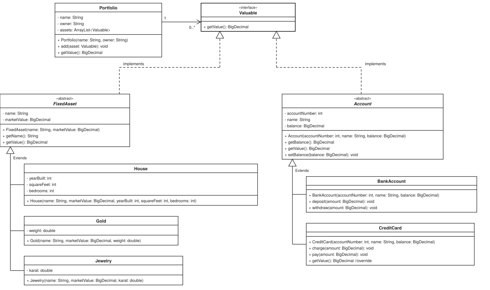

# Portfolio Manager

A Java console app from Workbook 6a. It uses a `Valuable` interface so that very different things, like a house, gold, a bank account and a credit card, can all report what they are worth.

## Class Diagram



## How It Works

- `Valuable` is an interface with one method, `getValue()`.
- `FixedAsset` is an abstract class for things you own: `House`, `Gold` and `Jewelry`.
- `Account` is an abstract class for money accounts: `BankAccount` and `CreditCard`.
- Both `FixedAsset` and `Account` say `implements Valuable`, so every class below them has `getValue()`.
- A `CreditCard` returns its balance as a negative number, because that is money owed.

## Project Structure

```text
portfolio-manager
├── pom.xml
├── README.md
├── Diagram.png
└── src/main/java/com/pluralsight/portfoliomanager
    ├── FinanceApplication.java
    └── model
        ├── Valuable.java
        ├── FixedAsset.java
        ├── House.java
        ├── Gold.java
        ├── Jewelry.java
        ├── Account.java
        ├── BankAccount.java
        └── CreditCard.java
```

## Sample Output

```text
Ranch house: $325000.00
Gold coins: $12000.00
Grandma's ring: $2500.00
Pam's balance: 12600
Gary's value: 1500
```

## What I Learned

`account1` is declared as a `BankAccount`, so I can call `deposit` on it. `account2` is declared as a `Valuable`, so the only method I can call is `getValue()`, even though the object is really a `BankAccount`. The variable's type decides what I can call, and the object decides which version runs.
